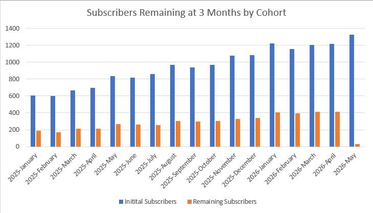
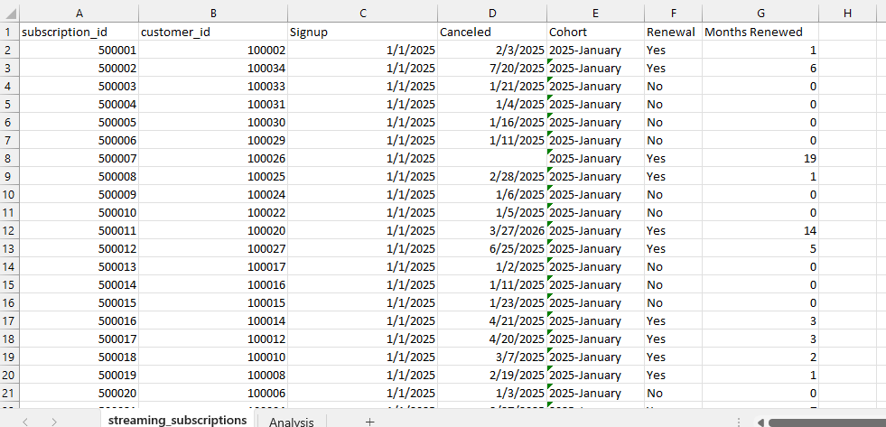
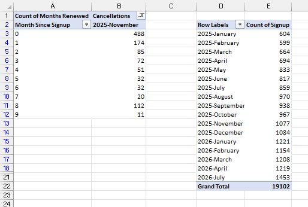
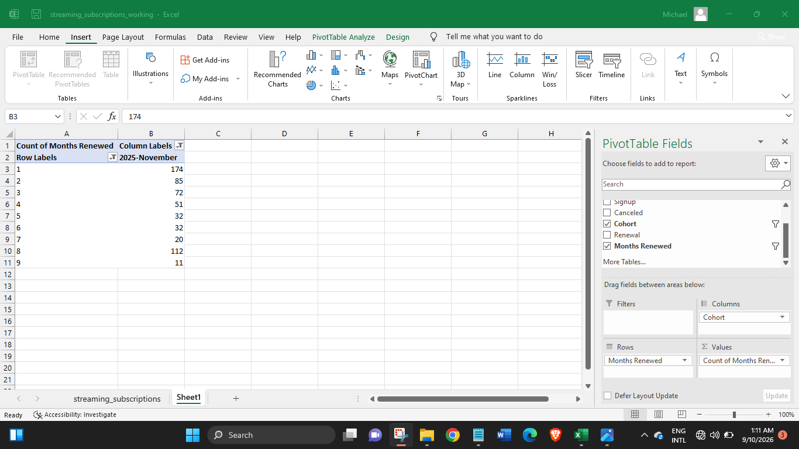
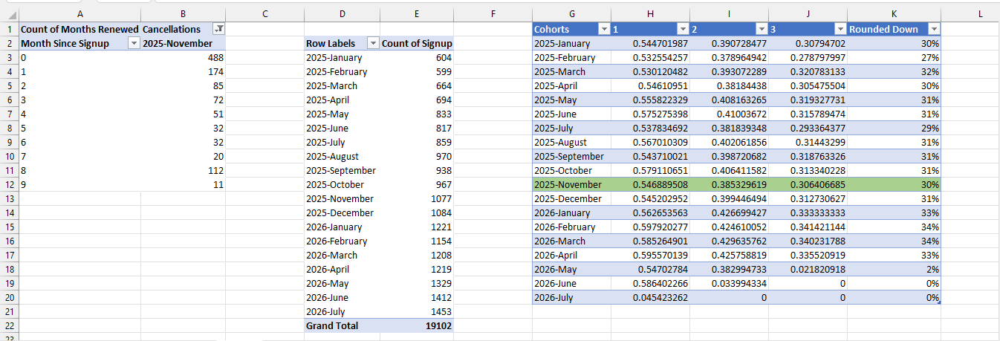
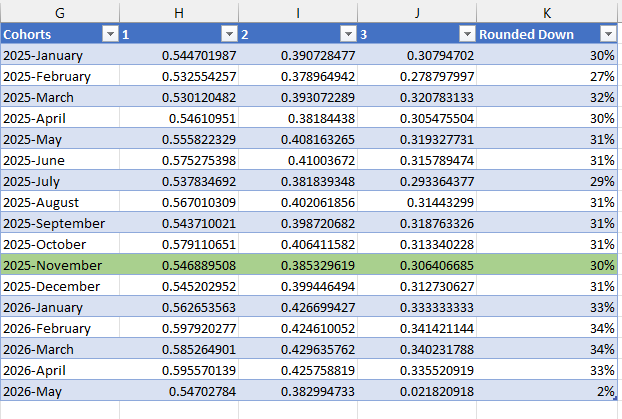
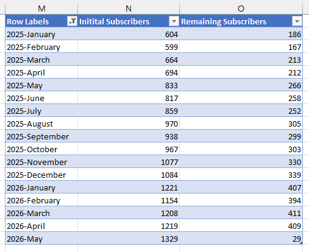

# Cohort Retention Analysis: Streaming Subscription Data

Do newer subscribers stick around longer than older ones, or does the same share of every signup group leave within a few months?

This project analyzes ~19,100 streaming subscriptions (Jan 2025 to Jul 2026) to answer:
- How many subscribers are still active 1, 2 and 3 months after signing up?
- Does retention differ between monthly signup cohorts?
- Is retention improving as the subscriber base grows?

## Dashboard

*Also showcased on [Maven Analytics](https://mavenshowcase.com/project/57675). The working file is `data/streaming_subscriptions_working.xlsx`, with all pivots and formulas intact.*

### Excel Workings

## Data

Streaming subscription records: one row per subscription with subscription ID, customer ID, signup date and cancellation date (blank if still active).

Working file: [`data/streaming_subscriptions_working.xlsx`](Data/streaming_subscriptions_working.xlsx)

## Process

1. Checked the raw data for duplicates (none found) and converted the `Signup` and `Canceled` columns from General to proper date format
2. Built a cohort column grouping each subscriber by signup month: `=TEXT(C2:C19103,"yyyy-mmmm")`
3. Calculated how many full months each subscription survived (`Months Renewed`) and flagged whether each subscriber renewed at least once (`Renewal`)
4. Built pivot tables for cohort size and for cancellations by months since signup
5. Calculated retention for each cohort: the share of subscribers who renewed for at least 1, 2 and 3 months, divided by cohort size
6. Charted initial subscribers against subscribers remaining at 3 months, by cohort

## Key Findings

- **The biggest drop happens right away** — Only 53-60% of each cohort is still subscribed after 1 month, meaning roughly 4 in 10 subscribers leave before renewing even once
- **Retention keeps falling, then levels off** — About 38-43% remain after 2 months and 27-34% after 3 months
- **Newer cohorts retain slightly better** — 3-month retention sat between 27% and 32% for most of 2025, then rose to 33-34% for the January to April 2026 cohorts
- **Growth is not coming at the cost of quality** — Monthly signups roughly doubled, from 604 (Jan 2025) to 1,200+ (early 2026), while retention held steady or improved
- **Caveat:** the May, June and July 2026 cohorts show near-0% at 3 months only because they haven't had 3 months to mature yet, so they are excluded from the comparisons above

## Tools

Excel (formulas, PivotTables, PivotCharts)

---
Data via the Maven Analytics streaming subscriptions dataset.
